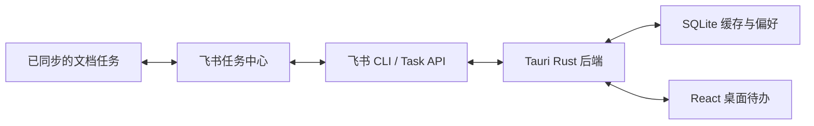

# 飞书桌面待办：需求与开发方案

版本：首版 0.1，2026-10-10。读者：使用者、开发者和验收人员。

> 在 Windows 上提供一个可拖动、可置顶的常驻待办小窗口。任务以飞书为准，本地仅保存缓存、显示偏好和“固定到今天”。完成必须由飞书确认。

## 1. 背景和目标

每天的工作记录在飞书文档中，查看和操作任务需要打开文档或任务中心。希望获得类似极序的桌面待办体验，并继续由飞书保存任务、人员、截止时间和完成状态。

使用者可以直接查看今日和逾期任务，在桌面完成任务，自动接收飞书侧变化，点击任务回到飞书或来源文档。不同标题相同的任务必须以 GUID 区分。

## 2. 首版范围及默认选择

用户授权继续开发，并要求以本文作为实施依据。未明确决定的产品事项采用以下首版默认值，后续可以调整。

| 事项 | 首版决定 |
| --- | --- |
| 使用对象 | 当前机器上的个人用户；不先做全公司权限和部署 |
| 数据范围 | 当前飞书用户“我负责的”未完成任务，不仅限于某份文档 |
| 今日待办 | 今日到期、日期早于今天的未完成任务、本机手动固定到今天的任务并集 |
| 无截止日期、未来任务 | 不自动加入今天，可在“全部待办”中固定到今天 |
| 固定到今天 | 本机偏好，不修改飞书截止日期；到次日自然失效 |
| 任务操作 | 完成和跳转；暂不新建、编辑、评论或管理子任务 |
| 定时同步 | 默认 5 分钟，可选 2/5/10 分钟；手动刷新立即执行，焦点恢复仅在同步间隔已到期时触发 |
| 桌面窗口 | 可拖动、调整大小、置顶开关、最小化和明确退出；首版不嵌入 Explorer 桌面层 |
| 缓存 | SQLite 保存映射和展示缓存。缓存过期时明确展示上次同步时间；断网不排队修改任务 |
| 便签和极序 | 首版只实现待办，不读取或修改极序数据库 |
| 开机启动、托盘、提醒 | 后续版本 |

“今日”按 Asia/Shanghai 的日历日期计算。全天任务根据日期判定，不能把当天零点或默认时刻误当作已经逾期。具体截止时刻可以在任务行显示，首版以到期日期分组。

## 3. 四个核心场景

### 查看任务

启动后识别飞书用户，加载该用户缓存，并立即同步。主视图展示今天到期和手动固定的任务，以及可折叠的逾期分组；全部视图用于找到未来或无截止日期的任务。顶部显示身份、上次同步时间和同步状态。

### 完成任务

1. 点击完成后，任务进入提交中，按钮禁用，保留原未完成状态。
2. 以 GUID 重新读取远端任务，检查当前用户仍为负责人、任务未完成和任务的完成方式。
3. 调用飞书完成操作，随后按同一 GUID 读取详情。
4. 只有读回 `status=done` 和有效 `completed_at` 后，任务才退出未完成列表。
5. 接口明确失败则保持未完成并展示原因；写入超时或读回失败时显示“结果待确认”，后续刷新以飞书为准，不盲目重复写入。

若任务已经被别人完成，则按已完成结果收敛，不再重复提交。多人或签任务需要用户在界面确认“完成整个任务”；多人会签任务首版跳转飞书完成个人份额，桌面不直接回写。此限制来源于尚未验证的个人完成语义，不把整体完成伪装成个人完成。

带 `custom_complete` 的业务任务在桌面提供跳转入口，由来源业务页面完成，避免绕过该任务自己的完成流程。

### 飞书侧修改

每次同步完整分页读取当前用户未完成任务。标题、负责人、截止时间、状态和链接以远端返回为准。飞书完成、删除、取消文档同步或改派后，任务可以从该用户列表消失；不能仅凭消失就记作“已完成”。分页中途失败不能使用残缺结果清空缓存。

### 查看来源

默认点击标题打开任务详情。若接口提供来源链接，另提供“查看来源”。链接打开前校验为 HTTP/HTTPS；任务 GUID 始终使用真实 API 字段，不从标题或展示编号猜测。

## 4. 数据模型和所有权

| 字段 | 远端来源或本地用途 |
| --- | --- |
| account_id + guid | 当前用户与任务 GUID 组成缓存隔离键 |
| title | `summary`，原样保存，支持长文本和换行 |
| status / completed_at | 飞书权威完成状态 |
| assignees / mode | `members` 中负责人及任务会签/或签方式 |
| due_timestamp / due_is_all_day | 期限的毫秒时间戳与全天日期标志 |
| updated_at | 飞书更新时间；不作为假定可用的增量查询参数 |
| task_url | 飞书返回的 `url` |
| source_url | `origin.href.url`，可为空 |
| pinned_date | 本机固定日期，不改飞书任务 |
| active | 是否出现在当前用户最近一次完整未完成列表中 |
| last_synced_at | 完整同步成功的时间 |
| 本地操作状态 | 界面中的提交中、结果待确认和失败，不作为远端完成事实 |

SQLite 不保存 app secret、access token、refresh token。缓存按用户隔离；切换身份后不展示或回写另一用户的任务。UI 不能传入任意命令，后端仅暴露固定业务操作。

## 5. 飞书前提及已取得证据

接入条件是“任务已同步到飞书任务中心，并能通过 Task API 获得 GUID”。不能仅凭文档复选框外观区分是否可接入。未同步的文档待办不在首版读取范围，需要先在飞书同步。

需要用户身份和 `task:task:read`、`task:task:write` 权限。若后续按指定任务清单读取，再申请相应清单读取权限。

2026-10-10 的真实 CLI 验证读取到 40 条未完成任务：今天到期 7 条、今天以前到期 29 条、无截止日期 4 条；其中 19 条来自文档，1 条为会签任务。两条同名测试任务完成、重开和再次读取均成功，GUID 隔离正确。这个数量是当时的快照，应用必须动态读取。

接口验证报告保存在开发者本机，不随公开仓库上传。测试没有修改已有工作任务。文档内勾选联动和飞书客户端手动修改后的桌面刷新仍需实际验收。

## 6. 技术方案

首版使用 React + TypeScript + Tauri 2，Rust 后端管理 CLI 适配、SQLite、分页、账号隔离和完成确认。无需独立业务服务器。

**登录接入的首版边界：**当前阶段复用已配置的本机 `lark-cli` 和其用户 OAuth。安装包可以携带 CLI 原生可执行文件，但不携带配置、应用密钥或用户令牌。在当前机器上可沿用已经验证的用户授权；未配置 CLI 的新机器需先配置飞书 CLI 应用。界面提供身份检查、授权二维码和完成授权入口。

此阶段不等同于“自研应用已完成独立 OAuth 发布”。后续面向员工分发时，应单独验证飞书公共客户端支持情况；如果授权码换令牌需要应用密钥，应由受信任服务保存密钥，不能硬编码进安装包。业务层通过固定适配器接口访问任务，后续可替换 CLI。

### 同步、错误和并发

- 同步和写入在后端串行执行，避免旧列表覆盖刚完成的结果。
- 全分页成功后在 SQLite 事务中替换活跃任务集合；部分失败保留上一次完整缓存。
- 远端 429、网络或服务异常使用退避重试，最长 5 分钟，界面可手动重试。
- 登录失效或缺少权限提示重新授权，不当作“没有任务”。
- 不自动重试写入；不确定结果通过读取收敛，用户确认仍未完成后可以再次提交。
- 缓存是展示辅助，写入前必须读取远端核对，离线时不产生本地完成状态。

## 7. 首版验收矩阵

| 编号 | 验收条件 | 验证方法 |
| --- | --- | --- |
| A01 | 正确读取当前用户任务，完整分页，无跨账号泄露 | 后端测试、真实只读诊断 |
| A02 | 今天、逾期、无期限、未来、全天日期、固定到今天正确 | 固定北京时间的边界用例 |
| A03 | 桌面完成后飞书状态真实变为 done | 独立测试任务的真实读写，随后核对 UI |
| A04 | 飞书完成/重开/改期限后桌面自动更新 | 完整同步测试、待用户侧实测 |
| A05 | 同名任务不会误操作 | 两条相同标题不同 GUID 的测试 |
| A06 | 失败、超时不产生本地假完成 | 失败注入、读回失败和缓存断言 |
| A07 | 重启后加载缓存并与飞书重新同步 | SQLite 重开测试、原生运行诊断 |
| A08 | 任务详情和来源可跳转 | URL 校验和用户实际跳转 |
| A09 | 缺权限、无登录、过期和缺 CLI 清楚提示 | 身份转换用例 |
| A10 | 2/5/10 分钟同步、手动刷新、退避恢复及焦点节流有效 | 时钟测试和界面测试 |
| A11 | 可拖动、调整大小、置顶和退出 | Tauri 构建与实际 Windows 验收 |
| A12 | 多人任务明确整体完成边界 | UI 确认、会签限制与后端校验 |

构建成功、自动测试通过、真实 API 通过和真人桌面验收分别记录，不能相互替代。状态更新在 `docs/开发与验收记录.md` 中维护。

## 8. 后续范围和方案比较

后续可支持创建和编辑任务、桌面重开、优先级、未来及已完成任务、开机启动、通知、清单切换、离线写入、托盘和快捷键。首版不做完整任务中心、多人项目管理、评论附件子任务管理或第二套独立任务数据库。

| 方案 | 取舍 |
| --- | --- |
| 飞书任务中心 | 数据天然一致，缺少常驻桌面体验 |
| 自研 Windows 组件 | 符合交互和同步目标，需要持续维护；本项目选用 |
| Microsoft To Do / Todoist 中转 | 增加另一套任务状态和冲突处理，首版不选 |
| 修改极序数据 | 无已验证公开接口，升级和一致性不可控，首版不选 |
| TaskBridge | 用户材料中作为 macOS/Apple 提醒事项案例，不作为 Windows 依赖；本次未验证其现状 |

## 公司值日制度扩展（2026-10-12 实施）

用户补充需求：桌面显示今日值日人员，普通同事不能随意修改。公司当前口头轮流值日，没有现成表格和指定维护人员。

按用户确认的方案创建飞书制度文档和一个 Base。现调整为四张表：轮值名单、轮值规则、值日调整、节假日日历；请假与临时调班合并到值日调整。管理员在飞书维护；桌面仅读取配置并按统一大小周算法显示今日值日，不实现独立管理员页面。

当前共有 12 名在职人员，名单和顺序由用户自行填写。每天人数为 1 人；单休周基准为 2026-10-05，2026 年官方放假与调休日已导入日历。请假规则现设为顺延补值：请假人员轮次保留，休假期间由后续可值日人员轮值，返岗后优先补值。临时休息、补班、指定代班和互换统一在值日调整中登记。桌面提供 14 天排班预览和单一值日调整入口。实施规则、入口、权限及验证边界见 [值日制度方案](值日制度方案.md)。

## 9. 来源

- 用户提供的《飞书任务桌面待办同步需求分析》及本次 CLI 读取/回写验证。
- [飞书：在文档中创建和管理任务](https://www.feishu.cn/hc/zh-CN/articles/545362352539-%E5%9C%A8%E6%96%87%E6%A1%A3%E4%B8%AD%E5%88%9B%E5%BB%BA%E5%92%8C%E7%AE%A1%E7%90%86%E4%BB%BB%E5%8A%A1)。
- [飞书 Task v2 列取任务](https://open.feishu.cn/document/uAjLw4CM/ukTMukTMukTM/task-v2/task/list)，实际参数以本机 `lark-cli schema task.tasks.list` 校验。
- [Tauri Windows 构建前提](https://v2.tauri.app/start/prerequisites/)。
- [Tauri 窗口 API](https://v2.tauri.app/reference/javascript/api/namespacewindow/)。

## 视觉规范（2026-10-10 调整）

界面采用白色主背景、石墨黑主文字、浅灰分隔线，少量蓝色用于固定、链接和提交状态。日期、负责人和同步时间使用灰色次级文字，逾期状态保留克制的棕色提示。去除原奶油绿配色与叶片装饰，标题简化为“今日待办”。

任务标题使用 13px 字号，信息通过间距和细分隔线组织；视图切换采用底部标记。任务列表、搜索、设置、授权和确认弹窗遵循同一套色彩变量；键盘焦点保留可见提示。

## 可切换主题（2026-10-10）

当前版本提供六种主题：雾蓝（蓝灰卡片）、暖纸（暖白手账）、墨夜（炭黑列表）、深海（深蓝青绿卡片）、暮紫（灰紫柔和卡片）、素白（黑白细线）。未选择过主题时默认使用雾蓝。

用户可通过顶部调色盘或“设置 → 外观主题”打开主题面板。点击主题立即生效，无需确认或重启；选择保存在当前 Windows 用户的 WebView2 本地存储中，重开后保留。主题设置只影响界面，不写入飞书，不与任务同步互相等待。本地存储不可用时仍可切换，并明确提示保存失败。

主题覆盖列表、窗口操作、搜索、设置、空状态、授权和确认面板。小窗口中的面板可滚动，标题与关闭入口保持可见；支持键盘选择和 Esc 关闭。

## 窗口位置记忆（2026-10-12）

正常退出时保存当前窗口的位置和大小，下次启动先恢复再显示。位置记录保存在当前 Windows 用户的应用配置目录，不写入飞书，也不随安装包或便携包分发。首次启动、记录损坏或原位置完全超出当前显示器时使用默认居中位置；最小化和最大化状态不作为下次启动的目标状态。

使用 Tauri 原生窗口状态插件处理保存及显示器范围检查。Windows 无边框窗口禁用原生阴影，避免启动恢复尺寸时把隐藏标题栏高度重复计入窗口大小；界面主题、置顶偏好和任务同步保持各自原有规则。

## 登录身份显示（2026-10-13）

未登录、授权失效或身份信息缺失时，底栏显示“未连接飞书”，任务列表不加载上次账号的缓存。CLI 保留的历史姓名不能用于判断已登录；必须同时确认当前授权可用、用户身份存在及任务读取权限。

登录成功后显示当前账号姓名；只读授权仍显示当前账号，完成任务需要另行取得写入权限。缓存按飞书用户 ID 隔离，授权失效时保留本机缓存但不展示，重新登录其他账号不会混入旧账号任务。安装包不包含开发者姓名、用户授权或个人缓存。

## 降低请求频率与客户端跳转（2026-10-10）

自动同步默认 5 分钟，设置可选 2、5、10 分钟。旧版已保存的 30/60 秒间隔升级为 5 分钟，窗口置顶设置保留。手动刷新立即执行；焦点恢复和定时刷新共同遵循距上次请求的间隔，避免切换窗口或刚手动刷新后又自动请求。失败后退避，最大等待 30 分钟。

任务标题使用 GUID 构造飞书官方支持的直接唤起链接：feishu://applink/client/todo/detail?guid=任务GUID&mode=app。由 Windows 注册的协议处理器打开飞书客户端；系统唤起返回失败时，回退原网页链接。来源按钮和授权网页保留各自的链接用途。

参考：
- [AppLink 结构及 feishu 降级协议](https://open.feishu.cn/document/common-capabilities/applink-protocol/applink-introduction/applink-structure)
- [打开任务详情页](https://open.feishu.cn/document/common-capabilities/applink-protocol/supported-protocol/open-todo/open-the-task-details-page)
